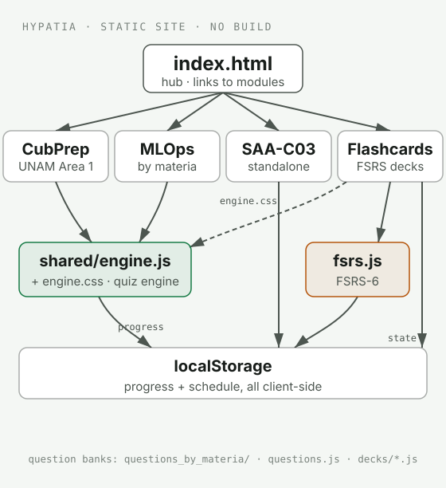

# Hypatia

Adaptive learning for neurodivergent minds: short sessions, clear feedback, and low-friction retries. Static HTML apps, no build step.

## Architecture and related repositories

Runs static practice modules in the browser. CubPrep and MLOps share an exam engine, SAA-C03 keeps its own implementation, and Flashcards uses its own FSRS scheduler.

- [Component guide and repository map](docs/stack.md): responsibilities, inputs, outputs and source references.
- [Explanatory diagram](docs/diagrams/system-map.html): select a node to inspect it. Download the HTML and open it in a browser.
- [Shared learning-stack architecture](https://github.com/G10hdz/learning-stack/blob/main/docs/architecture.md): where this repo fits in the whole system.

## Modules

| Module | What |
|--------|------|
| [CubPrep](./CubPrep/) | UNAM Area 1 exam practice |
| [PrepAWS](./SAA-C03/) | AWS Solutions Architect Associate (SAA-C03) practice |
| [MLOps](./MLOps/) | MLOps practice, questions grouped by materia |
| [Flashcards](./Flashcards/) | FSRS-6 spaced-repetition decks (`Flashcards/decks/`) |

`shared/` holds the engine (`engine.js`, `engine.css`) the exam modules reuse; `Flashcards/fsrs.js` is the scheduling engine covered by the test suite.

<picture>
  <source media="(prefers-color-scheme: dark)" srcset="docs/assets/architecture-dark.svg">
  
</picture>

## Run locally

Serve over HTTP (required for module scripts and storage):

```bash
python3 -m http.server 8080 --bind 127.0.0.1
```

Open `http://127.0.0.1:8080/` for the hub, or go straight to a module's `index.html`.

## Tests

```bash
node scripts/test-fsrs.mjs
```

Zero dependencies: a truth table for the FSRS-6 scheduling engine plus a smoke test of `index.html`. CI runs it on every PR.

## License

MIT
