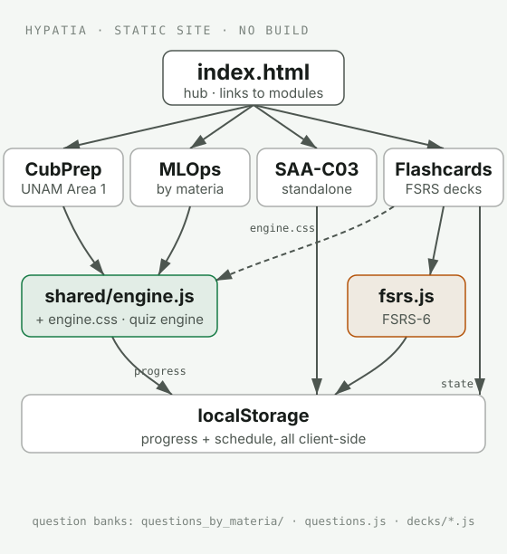

# Hypatia

Adaptive learning for neurodivergent minds: short sessions, clear feedback, and low-friction retries. Static HTML apps, no build step.

## Architecture and related repositories

Runs static practice modules in the browser. CubPrep and MLOps share an exam engine, SAA-C03 keeps its own implementation, and Flashcards uses its own FSRS scheduler.

- [Component guide and repository map](docs/stack.md): responsibilities, inputs, outputs and source references.
- [Explanatory diagram](docs/diagrams/system-map.html): select a node to inspect it. Download the HTML and open it in a browser.
- [Shared learning-stack architecture](https://github.com/G10hdz/learning-stack/blob/main/docs/architecture.md): where this repo fits in the whole system.

## Modules

| Module | What |
|--------|------|
| [CubPrep](./CubPrep/) | UNAM Area 1 exam practice |
| [PrepAWS](./SAA-C03/) | AWS Solutions Architect Associate (SAA-C03) practice |
| [MLOps](./MLOps/) | MLOps practice, questions grouped by materia |
| [Flashcards](./Flashcards/) | FSRS-6 spaced-repetition decks (`Flashcards/decks/`) |
| [Labs](./Labs/) | Interactive lessons (idea → figure → maths → code → real work → check-yourself). Tracks mirror the study-buddy notebooks; figures run on `shared/figures.js` |

`shared/` holds the engine (`engine.js`, `engine.css`) the exam modules reuse; `Flashcards/fsrs.js` is the scheduling engine covered by the test suite.

## Learning studio

The home page and `Labs/` are organized as a learning studio around eight conceptual areas (math, AI, systems, optimization, business, management, culture, communication), not around the apps the material came from. `Labs/knowledge-map.js` is a small curated dataset that powers the "Mapa de conexiones" on the home page and the per-lesson "Conecta con" sections: it is associative navigation between topics, not a prerequisite graph.

`shared/studio.css`, `shared/theme.js`, `shared/figures.js`, `shared/learning-state.js`, `shared/quiz.js`, `shared/resources.js` and `shared/map.js` are the studio layer the hub and the lessons share.

### Local-only data

Progress (`hypatia.learning.v1`), theme (`hypatia.theme.v1`) and the personal resource library live in this browser's `localStorage` only. There are no accounts and nothing is sent anywhere; clearing site data erases them. There is also no memory or cross-device sync: a saved link or a finished quiz on one device does not appear on another. The resource library stores HTTPS links you add yourself (NotebookLM, audio, briefs); it never fetches or embeds them, and the links keep whatever permissions they have at their provider.

Design notes: `docs/001-learning-studio.md`; Labs background: `docs/labs.md`.

<picture>
  <source media="(prefers-color-scheme: dark)" srcset="docs/assets/architecture-dark.svg">
  
</picture>

*The diagram above predates the studio: it covers the legacy practice-engine modules, not the topic map or the Labs studio layer.*

## Run locally

Serve over HTTP (required for module scripts and storage):

```bash
python3 -m http.server 8080 --bind 127.0.0.1
```

Open `http://127.0.0.1:8080/` for the hub, or go straight to a module's `index.html`.

## Tests

```bash
node scripts/test-fsrs.mjs         # FSRS-6 scheduling engine
node scripts/test-lab-models.mjs   # frozen lesson models (Bayes, capacity)
node scripts/test-studio.mjs       # studio state, resources, quiz, map
```

Zero dependencies: a truth table for the FSRS-6 scheduling engine, the frozen lab-model facts, and the studio behavior suite. CI runs all three on every PR.

## License

MIT
